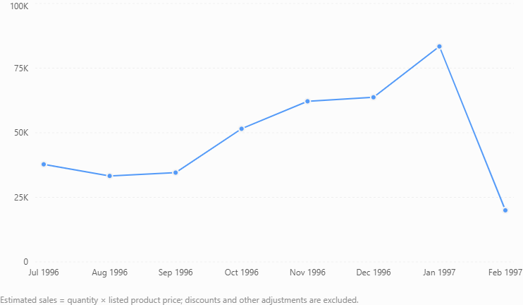

# Northwind SQL Business Analysis

## Project Overview

This project uses SQL to analyze the Northwind sample database and answer business questions related to order values and employee performance.

## Business Question

Which employees are responsible for the five highest-value orders and should be considered for bonuses?

## Dataset

The project uses the Northwind sample database, which contains the following tables:

- Customers
- Categories
- Employees
- OrderDetails
- Orders
- Products
- Shippers
- Suppliers

## SQL Skills Demonstrated

- Multi-table JOINs
- Aggregate functions (`SUM`)
- Calculated fields
- GROUP BY
- ORDER BY
- LIMIT
- Business-focused data analysis

## SQL Analysis

### Business Question

Which employees are responsible for the five highest-value orders and should be considered for bonuses?

### SQL Query

```sql
SELECT TOP 5
    o.OrderID,
    e.EmployeeID,
    e.FirstName,
    e.LastName,
    SUM(od.Quantity * p.Price) AS OrderAmount
FROM Orders AS o
INNER JOIN Employees AS e
    ON o.EmployeeID = e.EmployeeID
INNER JOIN OrderDetails AS od
    ON o.OrderID = od.OrderID
INNER JOIN Products AS p
    ON od.ProductID = p.ProductID
GROUP BY
    o.OrderID,
    e.EmployeeID,
    e.FirstName,
    e.LastName
ORDER BY
    OrderAmount DESC;
```

### Approach

The query joins orders with employee records, order details, and product information. It calculates each order's value by multiplying the quantity of each product by its listed price and summing the results for each order. The results are sorted in descending order, and `TOP 5` returns the five highest-value orders.

### Analysis 2: Total Sales by Employee

**Business Question:** Which employees generate the highest total sales across all their orders?

**Approach:** The query joins the Employees, Orders, OrderDetails, and Products tables. It calculates estimated sales by multiplying product quantities by listed prices, sums the values for each employee, counts distinct orders, and sorts employees by total sales in descending order.

**Key Finding:** Margaret Peacock ranked first among the employees shown, generating estimated sales of 105,696.50 across 40 orders. Nancy Davolio ranked second with 57,690.39 across 29 orders.

**Business Recommendation:** Management could use employee sales totals and order counts as part of a broader performance review. Additional measures, such as profit margins, customer satisfaction, and order complexity, should also be considered before making bonus decisions.

### Analysis 3: Sales by Product Category

**Business Question:** Which product categories generate the highest sales?

**Approach:** The query joins Categories, Products, OrderDetails, and Orders. It calculates estimated sales by multiplying product quantities by listed prices, sums the quantity sold, counts distinct orders, and ranks categories by estimated sales in descending order.

**Key Findings:**
- Beverages ranked first in estimated sales at 99,464.50 across 80 orders.
- Dairy Products recorded the highest quantity sold, with 2,601 units and estimated sales of 69,921.00.
- Grains/Cereals recorded the lowest estimated sales, at 22,327.75.

**Business Recommendation:** Management could use these results to review inventory availability and purchasing plans for high-performing categories such as Beverages and Dairy Products. Lower-sales categories should be investigated further before changing stock levels, taking profitability, seasonality, and customer demand into account.

### Analysis 4: Customer Purchasing Behavior

**Business Question:** Which customers spend the most, and how many orders do they place?

**Approach:** The query joins Customers, Orders, OrderDetails, and Products. It calculates estimated customer spending using product quantities and listed prices, counts distinct orders, and sorts customers by estimated spending in descending order.

**Key Findings:**
- Ernst Handel ranked first in the displayed results, with estimated spending of 35,631.21 across 10 orders.
- Mère Paillarde ranked second, with estimated spending of 23,362.60 across 5 orders.
- Save-a-lot Markets ranked third, with estimated spending of 22,500.06 across 4 orders.

**Business Recommendation:** Consider targeted retention initiatives for high-spending customers, while investigating whether customers with fewer orders could be encouraged to purchase more frequently. Use additional information, such as profit margins and customer history, before deciding which customers to prioritize.

### Analysis 5: Monthly Sales Trends

**Business Question:** Which months generate the highest sales?

**Approach:** The query joins Orders, OrderDetails, and Products. It calculates estimated sales from product quantities and listed prices, counts distinct orders, and groups results by year and month.

**Key Findings:**
- January 1997 recorded the highest estimated sales in the displayed period, at 83,400.47 across 33 orders.
- February 1997 recorded the lowest estimated sales in the displayed period, at 19,978.91 across 11 orders.
- Estimated sales rose from October 1996 through January 1997, then declined in February 1997.

**Business Recommendation:** Management could use monthly sales trends to support inventory planning and staffing decisions. Before interpreting the February decline as a seasonal pattern, analyze a longer period and consider factors such as discounts, product availability, and changes in customer demand.


### Monthly Sales Trend Visualization



The chart shows estimated monthly sales from July 1996 to February 1997. Sales peaked in January 1997 before declining in February. Further analysis is needed to determine the cause of this decline.


## Key Findings

The SQL analysis identified the five highest-value orders in the Northwind sample database.

- **Steven Buchanan** was responsible for the highest-value order, Order 10372, with a calculated value of 15,353.60.
- **Robert King** appeared twice among the five highest-value orders.
- **Margaret Peacock** also appeared twice among the five highest-value orders.
- The five orders had a combined calculated value of 66,495.35.

These values were calculated by multiplying each product's quantity by its listed price and summing the results for each order. Discounts, shipping charges, and other adjustments were not included.

## Tools

- SQL
- W3Schools SQL Tryit Editor
- GitHub

## Limitations

The estimated order values are based on product prices and quantities. Discounts, taxes, shipping costs, and other adjustments are not included unless explicitly represented in the dataset.

## Conclusion

This project demonstrates how SQL can combine relational data, calculate order values, rank results, and support business decisions.
